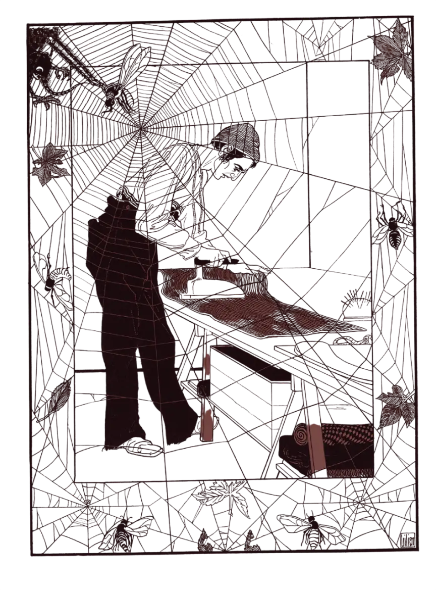

	
## 웹사이트를 가진다는 것

> 갑자기 사람들은 홈페이지나 웹 페이지를 만드는 대신, 웹페이지 안의 폼 입력란이나 텍스트 영역에 컨텐츠를 작성하기 시작했습니다.
> 
> [How the Blog Broke the Web](https://stackingthebricks.com/how-blogs-broke-the-web/)

인터넷이라하면 이제 인스타그램과 트위터가 먼저 떠오르고, 네이버 블로그에 사진을 투하하는 것이 다음으로 떠오른다. 
웹에서의 사적인 공간을 가지는 것? 이제는 그것이 이상한 일로 보인다. 멋있어 보이기도 하고.. 실은 아주 아주 귀찮은 일이기도 하고. 적막한 사막에 홀로 있는 것 같기도 하다. 모임별을 한창 듣던 시절, 모임별의 옛날 게시판에 대한 전설같은 이야기는 홈페이지 만들기에 대한 막연한 환상을 품게하기도 했다. 
그렇다. 홈페이지 만들기는 옛날에 유행하던 일이였다. 옛날이라 함은 2000년대 초. 내가 인터넷을 접하기 이전이다.. 초등학교때는 다들 나모 웹에디터를 배웠던 것이 기억난다. 승현이는 컴퓨터를 좋아한다는 이유로 아무것도 모른채로 나모 웹에디터 대회를 나갔다고 한다. 

친구들의 홈페이지 같은 것을 본 기억은 없었다. 그보다는 싸이월드 미니홈피를 했었지. 또 내가 다닌 초등학교에서는 특이하게도 학교 홈페이지에서 블로그를 만드는 기능이 있었다. 반마다 있는 학급 홈페이지와 학교 블로그는 생각보다 활성화되었다. 지금 생각하면 유치하고 부끄러운 일이지만, 네이버 카페에서 알게된 사람의 글과 위악스러움이 멋있어 보여 학급 홈페이지와 블로그에 비슷하게 글을 쓰고, 블로그도 따라 꾸몄었다. 중2병이라는 것이 정말 일찍 왔다.. 그때의 블로그와 미니홈피와 카페들, 그때의 순수하고 자유로운 분위기가 어렴풋이 기억이 난다. 상단에 뮤직 플레이어를 누르면 음악이 흘러나왔다. 이것이 인터넷과 홈페이지에 대한 내 첫번째 기억이다.

> [식당 웹사이트는 왜 훌륭할까? 그리고 우리는 왜 그걸 그리워하게 될까?](https://neworder.xyz/stories/why-restaurant-websites-are-good-and-we-re-all-going-to-miss-them#main)

그러나 지금의 웹은 그때의 웹과 다르다. [페이지의 사이즈는 5배 이상 증가했고](https://httparchive.org/reports/page-weight?lens=top10k&start=earliest&end=latest), 소수의 테크 기업이 소유한 웹사이트가 전세계의 네트워크 트래픽의 절반 이상을 차지하고 있다. (올해는 봇이 만드는 트래픽이 인간의 것을 추월했다는 기사도..) 거대한 플랫폼 회사들은 수많은 다른 웹사이트들을 흡수해왔다.(말 그대로 인수합병하여) 이들의 웹사이트는 거대한 앱이자 생활공간이 되어가고 있으며, 그 비대한 크기와 AI 모델 개발 및 기능의 도입 때문에 이들의 기술은 데이터센터, 착취적인 AI 인프라등을 아우른다. 
테크 기업의 방식을 따라 웹사이트를 만든다면, 알아야 할 사전 지식이 너무 많다. 현대 웹 개발의 생태계는 몇겹의 코드 거미줄로 중첩되어 있고 각각의 코드가 의존하는 구조가 너무 복잡해졌다. 생성형 AI를 사용하여 흉내낸다고 해도, 그 결과물은 여전히 복잡성을 가지고 있고 코드를 이해하거나 수정하는 것에는 사전 지식이 필요하다. (그냥 전부다 AI한테 맡겨버리면 되지 않느냐는 반박은 여기서 다루지 않을 것..[^1]) 테크 기업의 웹은 멈퍼드나 슈마허가 말하는 '거대 기술'이다. 거대 기술은 전문가에 의존적이고, 착취적이며 생태적으로도 지속가능하지 않다.

그 반대편에는 단순한 기술들이 있다. 뭐 사업할 것도 아니고 단순해도 될 것 같다. 서구 인터넷에서는 HTML과 CSS, 최소한의 Javascript를 사용하는 홈페이지 만들기를 스몰웹, [인디웹](https://indieweb.org/), [핸드메이드 웹](https://luckysoap.com/handmadeweb/handmadeweb_korean.html)이라고 부르는 것 같다. 요즘에는 [디지털 정원](https://maggieappleton.com/garden-history)이라고도 부른다.

> 정원은 위상학적 관점에서 보는 웹입니다. 공간으로서의 웹이자, 통합적인 웹이고, 반복적인 웹이며, 사물들이 서로를 재배열하는 웹입니다.
>
> [The Garden and the Stream: A Technopastoral](https://hapgood.us/2015/10/17/the-garden-and-the-stream-a-technopastoral/)

디지털 정원에 대한 아이디어는 흥미롭다. 처음엔 이름이 흥미로워서 찾아 봤다. 엉성한 기계번역과 함께 몇가지 글들의 행간 속에 다소 해멨지만.. 
디지털 정원은 비독점적인 자료 교환을 가능하게 했던 [초기 웹의 전망](https://www.w3.org/History/1989/proposal.html)을 다소 되살리는 것만 같다. 월드 와이드 웹(www)은 컴퓨터에 있는 문서를 열람하고, 문서에 링크를 추가하여, 서로 다른 컴퓨터안에 있는 문서를 연결할 수 있게 했다. 비슷하게 정원은 탐색할 수 있는 여러 하이퍼링크로 연결된 페이지들이고, 일관된 레이아웃이 없을 수도 있다. 시간 순으로 나열되는 블로그 피드와 달리, 정원은 다른 글, 페이지들에 걸린 [하이퍼링크](https://ko.wikipedia.org/wiki/%ED%95%98%EC%9D%B4%ED%8D%BC%EB%A7%81%ED%81%AC)에 어느정도 의존한다. 위키피디아에 가깝다고 볼 수 있겠다. 하나의 문서에 걸린 많은 각주들과 파란색 링크들에 현혹되면 어느새 토끼굴에 빠진다. 정원은 길을 잃게한다. 언젠가 <a class="visited" href="https://frankstainlove.xyz">방문한 페이지</a>에는 새로운 내용들이 자라나 있다. 어떤 링크들은 더이상 들어갈 수 없다.[^2]

정원과 반대되는 웹의 형태는 스트림 stream, 흐르는 물, 즉, 한방향으로만 흐르는 것이다. 스트림은 더 짧고 수다스럽고, 더 시간에 의존한다. 그야말로 보고 있다보면 휩쓸린다. 날짜 순, 알고리즘 순으로 정렬된 피드, 트윗, 스레드 그리고 블로그가 대표적인 예시다. (트위터에서 논쟁이 일어날때 맥락을 이해하기 위해서 이전 트윗을 찾게되는데 그 거슬러 올라가는 과정이 쉽지 않다 🫠) 심지어 인스타그램은 게시물에서 하이퍼링크 기능을 제한한다. 그래서 피드의 흐름에서 벗어나 다른 앱, 다른 사이트로 넘어가는 것이 되게 귀찮다.. 또, 이제 스트리밍되는 영상들은 짧아지거나 2배, 3배 속도로 아주 빠르게 재생된다! 망할 릴스! 망할 숏츠! 긴 영상은 이제 수면제 대용이 되고 있을지도 모른다. 스트림 페이지는 블로그(blog)의 풀네임인 웹로그(web log)가 그 시초라고 할 수 있겠다. 날짜순으로 게시물을 링크하는 페이지로, 블로그의 초창기 형태이다. 스트림 형태의 페이지가 나쁘다고만 할 순 없겠지만 그 특유의 레이아웃이 지겹긴 하다. 웹페이지는 더 다양한 형태를 가질 수 있지 않을까? 또 어떤 컨텐츠를 봐야하는지도 알고리즘에 의해 통제받는 것은 기분 나쁜 일이다.. (인스타에 빨려들어가서 원래 뭐하려고 했는지 까먹어본적 있는 사람?)

다들 생성형 AI에 별 거부감 없는 것 같아 보이는 한국에서 인디웹이라는 것이 내 홈페이지라는 것이 무슨 의미를 가질 수 있을까? 비싼 수업료를 내야하는 또다른 힙한 문화? 컴퓨터 앞에서 저항이다 뭐다하는 허영? 이까짓거 프롬프트 몇번 먹이면 만들 수 있는 것일까? 글쎄 모르겠다. 우선 플랫폼이 싫다는 마음이 크다.(다들 열심히 하니까 습관적으로 키는) 플랫폼들은 내가 모르는 온갖 곳들에 나의 데이터를 보내고, 다른 플랫폼에서 온 나의 데이터로 내가 보는 컨텐츠를 조정한다. 요즘에는 AI 학습에 이용하느니 마느니 하는 읽기도 싫은 약관을 들이밀기도 하고.. 설정 페이지 깊숙한 어딘가에 약관 비동의 버튼을 숨겨놓거나.. 순전히 그런 추잡한 음모가 도사리는 곳에서 머무는 시간을 줄이고 싶다는 생각. 당신들의 계략에 휘말리지 않겠다는 아집. 어쩐지 [아나키스트의 향기](https://semacoral.org/features/doohoyi-the-small-internet-and-the-scent-of-anarchists)가 나는 행위들이다. 

(지금 이곳은 github page를 통해 호스팅되고 있는데, 얼른 셀프호스팅을!)

[^1]: 지속불가능한 산업사회의 인프라 위에 쌓아 올린 AI 인프라로 유지보수하는 웹사이트는 문제적이라고 본다. 또한, 생성형 AI를 통해 기술 민주주의 문제를 우회해보아도, 넓은 층위에서도, 긴 시간의 관점에서도 문제는 해결되지 않는다.
[^2]: 타임머신을 타고 과거로 돌아간다면 들어갈 수 있을지도 모른다! ➲ [wayback machine](https://web.archive.org/)

